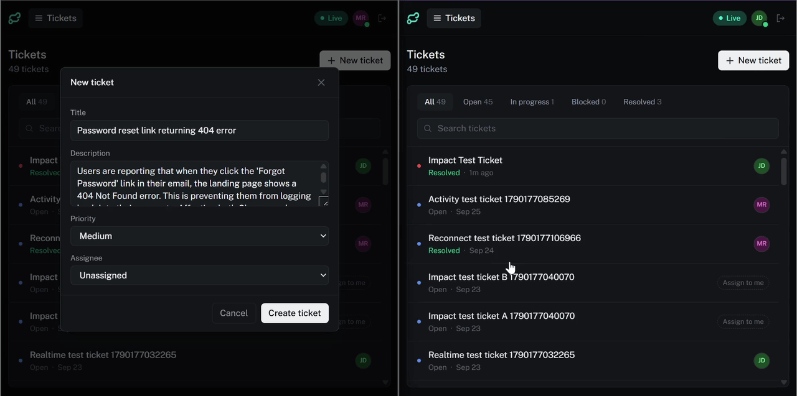
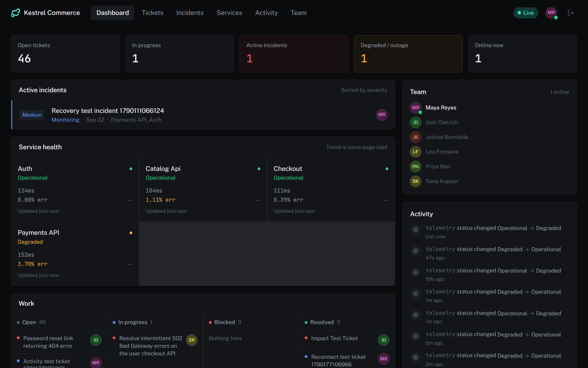
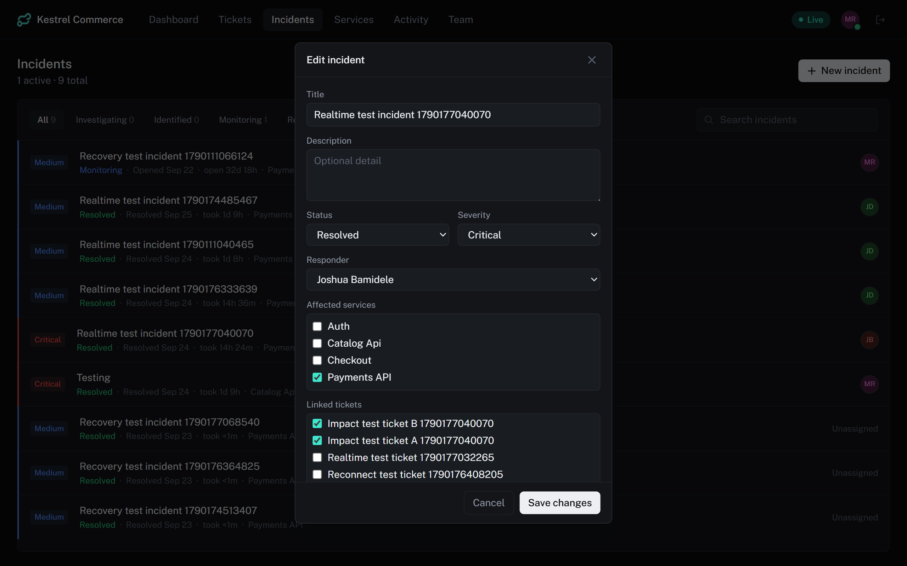
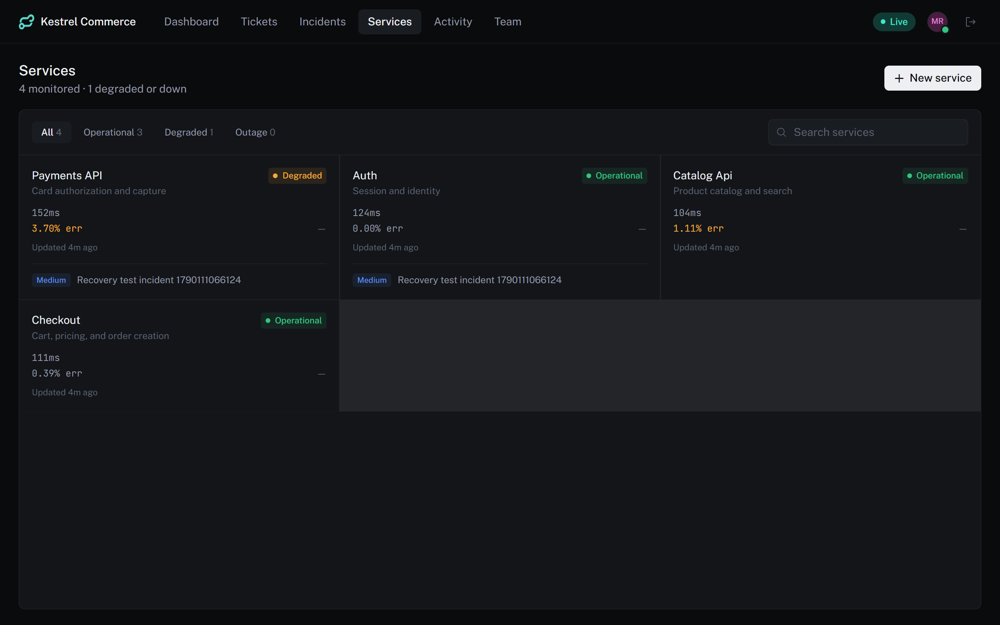
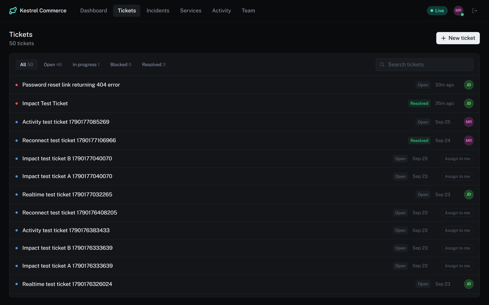
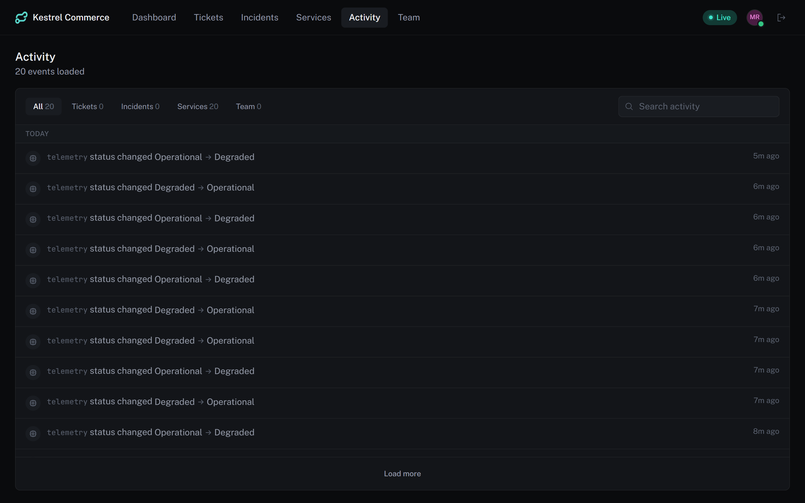
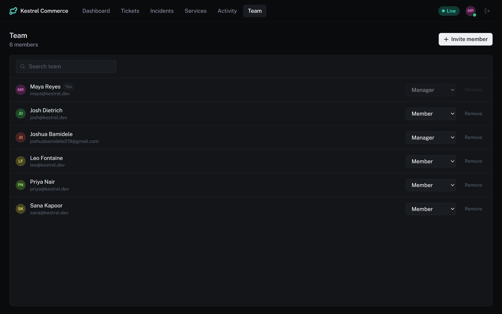

# Relay

A real-time operations platform for small SaaS teams. Relay puts **work**, **system health**, **people**, and **events** in one live view, so when something breaks you don't have to piece together what happened, what's affected, and who's on it from five different tools.

Everything on screen is live: a ticket created in one browser appears in another without a refresh, a service degrading flips the dashboard, and teammates' presence updates as they come and go.



## Screenshots



| Incident | Services |
|---|---|
|  |  |
| **Tickets** | **Activity** |
|  |  |



## Features

- **Tickets** — create, assign, prioritise, and move work through its statuses, with optimistic updates and conflict detection when two people edit the same ticket.
- **Services & health** — monitored services with latency, error rate, and status (operational / degraded / outage). Telemetry is simulated by a standalone worker, so there's always something moving.
- **Incidents** — declare incidents, link affected services and related tickets, track who's responding, and see recovery as it happens.
- **Activity stream** — a paginated, real-time history of everything that changed, attributed to who did it.
- **Presence** — see who's online right now.
- **Dashboard** — one composed view of all of the above.
- **Team management** — invite teammates by link, change roles, deactivate members. Managers only, with guards against removing the last manager.
- **Multi-tenant** — every query is scoped to an organization; realtime channels are authorized per org.
- **Auth** — JWT access + refresh tokens in cookies, silently refreshed by Next's proxy. Two roles: Manager and Member.

## Stack

| | |
|---|---|
| Framework | Next.js 16 (App Router, Server Actions), React 19, TypeScript |
| Styling | Tailwind CSS 4 |
| Data | PostgreSQL via Prisma 7 (`@prisma/adapter-pg`) |
| Realtime | Supabase Realtime (Broadcast + Presence) with Realtime Authorization. Supabase is used for Postgres hosting and Realtime only, **not** for auth |
| Client state | TanStack Query 5 |
| Auth | `jose` (JWT), scrypt password hashing |
| Validation | Zod |
| Testing | Playwright (end-to-end) |

## How it's put together

```
app/ + components/         Presentation: pages, client views, shared UI
        │  Server Actions
        ▼
server/application/        Use-cases: validate → authorize → persist → record activity → broadcast
        │
        ├── server/domain/        Pure business rules (status from telemetry, team-change guards)
        ├── server/validation/    Zod schemas, the single definition of "valid input"
        └── server/repositories/  Prisma queries; every function takes orgId first
                                  (tenant isolation lives here)

server/realtime/           Org-scoped Broadcast after each committed mutation
workers/telemetry.ts       Standalone long-lived process writing simulated service telemetry
proxy.ts                   Refreshes expired access tokens before a page renders
```

A few decisions worth knowing about:

- **The database is the source of truth; realtime only says "something changed."** Broadcast events trigger TanStack Query invalidation and the client refetches. There's no second client-side copy of domain state to drift.
- **Mutation and activity record share a transaction**, so the activity feed can't disagree with the data.
- **Streaming SSR.** Each dashboard route prefetches its queries on the server, hydrates them with `HydrationBoundary`, and has a `loading.tsx` skeleton shaped like the real view, so cold loads don't flash empty content and shift layout. Prefetches use `queryClient.query(...).catch(noop)` rather than the deprecated `prefetchQuery`.
- **Reconnect handling.** Missed events during a disconnect are reconciled by refetching on reconnect, with a connection banner while offline.

The full product spec and architecture write-up is in [`RELAY_README.md`](./RELAY_README.md), and the build history is in [`BACKEND_ROADMAP.md`](./BACKEND_ROADMAP.md).

## Getting started

### Prerequisites

- Node.js 20.9+ (required by Next.js 16)
- Yarn 4 (`corepack enable`)
- A PostgreSQL database
- A Supabase project (for Realtime)

### 1. Install

```bash
yarn install
```

### 2. Configure environment

Create `.env` in the project root:

```bash
DATABASE_URL=postgresql://...            # your Postgres connection string
JWT_SECRET=...                           # long random string; also the Supabase JWT secret (HS256)

NEXT_PUBLIC_SUPABASE_URL=https://<project>.supabase.co
NEXT_PUBLIC_SUPABASE_ANON_KEY=...
SUPABASE_SERVICE_ROLE_KEY=...

# optional
TELEMETRY_TICK_MS=4000                   # how often the telemetry worker ticks
```

### 3. Set up Supabase Realtime

Relay uses **Realtime Authorization**, so this needs doing once per project:

1. In Realtime Settings, turn on authorization for Broadcast/Presence.
2. Add RLS policies on `realtime.messages` keyed on the `org_id` claim in the JWT, so each user can only join their own org's `org:{orgId}` channel.

The policy design is described in `RELAY_README.md` (sections 31 and 38) and `BACKEND_ROADMAP.md` (Milestone 3). These policies are not part of the Prisma migrations.

### 4. Database

```bash
yarn prisma migrate deploy --config prisma7.config.ts
yarn prisma db seed --config prisma7.config.ts
```

The seed creates one organization, five users, and three services. It is idempotent, so re-running it is safe.

### 5. Run

```bash
yarn dev                  # the app, on http://localhost:3000
yarn worker:telemetry     # in a second terminal: simulated service telemetry
```

Without the worker, service health stays static. Start it to see services drift into degraded and outage states.

### Demo accounts

Seeded accounts all share the password `relay-dev-1234` (dev/demo only):

| Email | Role |
|---|---|
| `maya@kestrel.dev` | Manager |
| `josh@kestrel.dev`, `sana@kestrel.dev`, `leo@kestrel.dev`, `priya@kestrel.dev` | Member |

Sign in as two different users in two browsers to watch changes sync live.

## Scripts

| Command | What it does |
|---|---|
| `yarn dev` | Start the dev server |
| `yarn build` | `prisma generate` + production build |
| `yarn start` | Serve the production build |
| `yarn lint` | ESLint |
| `yarn worker:telemetry` | Run the telemetry worker |

## Testing

**End-to-end (Playwright).** The two-browser-context test in `e2e/ticket-realtime.spec.ts` is the acceptance test for the whole realtime story: one user acts in browser A, browser B sees it with no reload. It covers ticket creation and assignment, incident creation, impact, response and recovery, service degradation, presence, and disconnect/reconnect reconciliation.

It needs a running database, a configured Supabase Realtime project, and a seeded org (steps 2–4 above):

```bash
yarn playwright install chromium
yarn playwright test
```

There are no unit or component tests yet. See [Known limitations](#known-limitations).

## Project layout

```
app/                 Routes: login, invite/[token], and the (dashboard) group
components/          Client views and shared UI, grouped by feature
lib/                 Shared helpers (formatting, permissions, action-result)
server/              Application, domain, validation, repositories, auth, realtime
prisma/              Schema, migrations, seed
workers/             Telemetry worker
e2e/                 Playwright specs
types/               Shared types and status metadata
```

## Not in scope

Relay is an MVP. It deliberately has no chat, email/SMS notifications, billing, mobile apps, third-party integrations, or automation. Service telemetry is simulated rather than collected from real infrastructure.

## Known limitations

- **Telemetry is simulated.** Service health comes from a worker that random-walks latency and error rate, not from real infrastructure.
- **The telemetry worker needs an always-on process.** It can't run as a serverless function, so a deployment on Vercel alone will show static service health unless the worker is hosted separately (Railway, Fly, Render, or similar).
- **Test coverage is end-to-end only.** The Playwright spec covers the realtime flows; unit and component tests are not written yet.
- **Realtime policies are manual.** The Supabase `realtime.messages` RLS policies are set up by hand, not through the Prisma migrations.